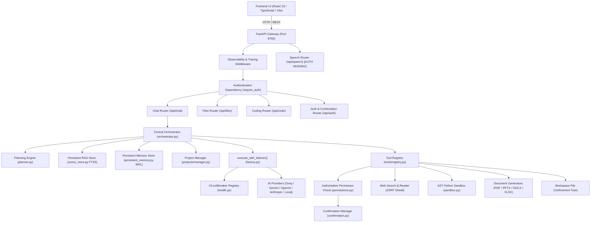

# JARVIS 2.0 — ARCHITECTURE & INTEGRATION MAP

**Audit Date:** November 24, 2026
**Auditor:** Principal Software Architect

---

## 1. System Topology & Dataflow

---

## 2. Integration Status & Disconnects

### 2.1 The Orchestrator Request Path
- **Current Reality**:
  1. `run_orchestration` accepts `session_id`, `user_text`, `mode`, `project_id`, `confirmed_action_id`.
  2. If `confirmed_action_id` is present, it executes the confirmed action via `execute_confirmed_action()`. **BUG**: Return format mismatches Pydantic schema alias.
  3. Detects intent via `planning_engine.detect_intent_and_plan(user_text)`.
  4. Scopes RAG lookup: `rag_store.search(user_text, session_id=sid)`.
  5. Assembles system prompt with memory preferences: `memory_store.build_system_context()`.
  6. Dispatches to `execute_with_failover()` in a synchronous while loop.
- **Disconnected Components**:
  - `ModelRouter`: Implemented in `services/ai/router.py`, but **never imported or called in `orchestrator.py`**.
  - `TaskGraph`: Implemented in `services/agents/task_graph.py`, but **never used for tool scheduling**.
  - `EventBus`: Referenced in `AGENTS.md` and `ARCHITECTURE.md`, but **non-existent in source code**.
  - Specialized Agents: `study_agent.py` and `document_agent.py` are isolated REST endpoints; orchestrator handles study and document requests via direct tool calls rather than delegating to these agents.

### 2.2 Frontend-Backend Integration Map

| Frontend Service | Backend Route | Protocol | Auth Status | Integration Health |
|:---|:---|:---|:---:|:---|
| `api/chat.ts::sendChatMessage` | `POST /api/chat` | HTTP JSON | ❌ Missing in FE | **Broken in Dev/Prod** (Returns 401) |
| `api/speech.ts::requestSpeech` | `POST /api/tts` | HTTP MP3 | ⚠️ Unenforced in BE | Working (Public endpoint) |
| `api/speech.ts::transcribeRecording`| `POST /api/transcribe`| HTTP Multipart | ⚠️ Unenforced in BE | Working (Public endpoint) |
| `api/files.ts::uploadFile` | `POST /api/files/upload` | HTTP Multipart | ❌ Missing in FE | **Broken in Dev/Prod** (Returns 401) |
| `api/settings.ts::fetchSettings` | `GET /api/settings` | HTTP JSON | ❌ Missing in FE | **Broken in Dev/Prod** (Returns 401) |
| `api/coding.ts::executeCode` | `POST /api/code/execute` | HTTP JSON | ❌ Missing in FE | **Broken in Dev/Prod** (Returns 401) |
| `api/projects.ts::fetchProjects` | `GET /api/projects` | HTTP JSON | ❌ Missing in FE | **Broken in Dev/Prod** (Returns 401) |
| `api/memory.ts::fetchMemories` | `GET /api/memory` | HTTP JSON | ❌ Missing in FE | **Broken in Dev/Prod** (Returns 401) |
| `api/diagnostics.ts::fetchDiagnostics`| `GET /api/diagnostics` | HTTP JSON | ⚠️ Unenforced in BE | Working |
| `api/capabilities.ts::fetchCapabilities`| `GET /api/capabilities`| HTTP JSON | ⚠️ Unenforced in BE | Working |

---

## 3. Recommended Remediation & Alignment Plan

1. **Unify Frontend HTTP Client**:
   Replace scattered `fetch()` calls in `jarvis-frontend/src/api/*.ts` with a central `apiClient` instance in `jarvis-frontend/src/api/client.ts`. The client automatically injects `Authorization: Bearer <token>` and handles session token acquisition.
2. **Wire `ModelRouter` into `run_orchestration`**:
   Import `model_router` in `orchestrator.py` and invoke `model_router.route(user_text, active_mode=mode)` before dispatching to `execute_with_failover()`.
3. **Connect Multi-Step Plans to `TaskGraph`**:
   When `plan.requires_tools` is true and has multiple independent steps, build a `TaskGraph` instance, validate DAG acyclicity, and execute nodes concurrently using the existing semaphore mechanism.
4. **Fix `ToolEvent` Pydantic Configuration**:
   Update `backend/app/schemas.py` to enable `populate_by_name = True` across all models with field aliases.
